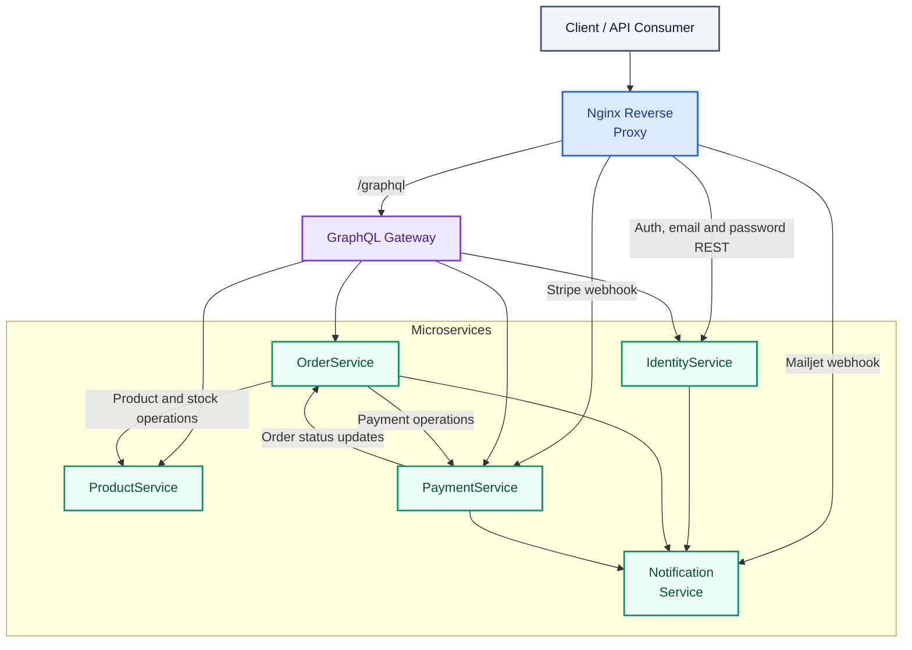
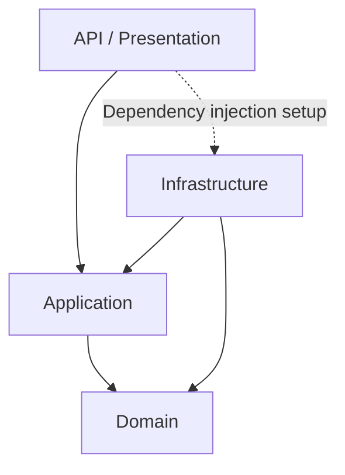

# 🛒 ECommerceLite

**A microservices-based e-commerce backend built with .NET 8**, focused on maintainable architecture, secure APIs, and reliable distributed workflows.
> 💡 **Design Philosophy:** I deliberately prioritized simplicity in the business logic, keeping the domain focused on essential e-commerce requirements and avoiding unnecessary features and overengineering. The goal was to apply solid backend architecture and engineering principles without adding complexity where it wasn't needed.

🏗️ Microservices · 🧅 Clean Architecture · ⚡ CQRS · 🔗 GraphQL · 🐳 Docker · 💳 Stripe

---

## 🏗️ Project Status


| Service | Status |
|---|---|
| 🔐 Identity Service | 🟢 **Completed** |
| 📦 Product Service | 🟢 **Completed** |
| 🛒 Order Service | 🟢 **Completed** [](https://github.com/MarwanMekkawy/ECommerceLiteProject-Backe-End-/actions/workflows/order-service-ci.yml) |
| 💳 Payment Service | 🟢 **Completed** |
| 🔔 Notification Service | 🟢 **Completed** |
| 🌐 API Gateway | 🟢 **Completed** |
| 🐳 Dockerization | 🟢 **Completed** |
| 🔗 Service Integration | 🟢 **Completed** |
---

## ✨ Key Features

- 🏛️ **Microservices Architecture** — Five services with clear responsibilities and separate databases.
- 🧅 **Clean / Onion Architecture** — Separation of domain logic, application use cases, infrastructure, and API layers.
- ⚡ **CQRS** — Command/query separation in `OrderService`.
- 🔗 **GraphQL Gateway** — Unified client-facing API built with Hot Chocolate.
- 🔐 **Authentication & Authorization** — JWT, refresh-token cookies, role-based access, and service-to-service authentication.
- 🛍️ **Order Management** — Cart operations, checkout validation, price snapshots, stock reservation, and order expiration.
- 💳 **Payment Processing** — Stripe integration, webhook handling, retries, and refunds.
- 📧 **Notification Processing** — Mailjet integration with persistent notifications and retry handling.
- 🐳 **Containerized Development** — Docker Compose for local orchestration.
- 🛡️ **Nginx Reverse Proxy** — Request routing and rate limiting.

## 🏛️ Architecture

### System Architecture

The application uses Nginx as its external entry point. Most client-facing business operations go through the GraphQL Gateway, while selected authentication, email, password, and provider-webhook endpoints remain REST-based.


**Communication and data ownership**

- Each microservice owns its business logic and database.
- Services communicate through explicit HTTP APIs.
- The Gateway provides a unified client-facing interface.
- Nginx routes selected REST endpoints directly to their owning services.
- Internal operations use dedicated service-to-service authentication where required.
- Cross-service workflows account for state transitions, duplicate events, retries, and recovery.

### Application Architecture

The services use Clean / Onion-style layering to separate business rules from infrastructure details.



- **Domain** — Business entities and domain rules.
- **Application** — Use cases, application services, and abstractions.
- **Infrastructure** — Database access, external integrations, and implementations of application abstractions.
- **API** — HTTP endpoints, request handling, and dependency-injection composition.

The dependency direction keeps core business logic independent of infrastructure implementations.

### Architectural Patterns

| Pattern | Application |
|---|---|
| Clean / Onion Architecture | Separation of concerns and dependency direction |
| CQRS | Command/query handlers in `OrderService` |
| Repository Pattern | Data access abstraction |
| Unit of Work | Coordinated persistence |
| Dependency Injection | Composition and implementation registration |
| Background Workers | Order expiration and notification processing |
| Idempotent Processing | Handling duplicate payment events safely |

## 🧩 Services

| Component | Responsibility |
|---|---|
| **IdentityService** | User accounts, authentication, roles, email verification, and password recovery |
| **ProductService** | Products, categories, pricing, and stock |
| **OrderService** | Cart management, checkout, order lifecycle, and expiration |
| **PaymentService** | Stripe integration, payment status, retries, and refunds |
| **NotificationService** | Email delivery, persistence, and retry processing |
| **GraphQL Gateway** | Client-facing queries and mutations, downstream communication, and authorization |
| **Nginx** | Reverse proxy, routing, and rate limiting |

## 🧰 Technology Stack

| Category | Technologies |
|---|---|
| Language & Framework | C#, .NET 8, ASP.NET Core |
| API | GraphQL, Hot Chocolate, REST |
| Architecture | Microservices, Clean / Onion Architecture, CQRS |
| Data Access | SQL Server, Entity Framework Core, Repository, Unit of Work |
| Validation & Mapping | FluentValidation, AutoMapper |
| Authentication | JWT, refresh tokens, role-based authorization |
| Payments | Stripe |
| Notifications | Mailjet |
| Infrastructure | Docker, Docker Compose, Nginx |
| Testing | xUnit v3, Moq |

## 🔄 Important Business Workflows

### 🛍️ Checkout & Order Lifecycle

- Validate current product prices and stock during checkout.
- Snapshot prices and totals for the order.
- Reserve stock and manage order state transitions.
- Handle expiration and stock restoration.

### 💳 Payment Processing

- Create and manage Stripe PaymentIntents.
- Process webhook events and update payment status.
- Support payment retries and refunds.
- Coordinate payment results with order state.

**An order being confirmed does not necessarily mean its payment has succeeded.**

### 🔐 Identity & Security

- Support registration, login, token refresh, email verification, and password recovery.
- Enforce role-based access and verified-email requirements where applicable.
- Protect customer resources with ownership checks.
- Authenticate internal service operations where required.

### 📧 Notification Processing

- Persist notifications for background processing.
- Retry failed email delivery.
- Process authenticated Mailjet webhook events.

## 🚀 Getting Started

### Prerequisites

- [.NET 8 SDK](https://dotnet.microsoft.com/download/dotnet/8.0)
- [Docker Desktop](https://www.docker.com/products/docker-desktop/)
- Git
- Stripe and Mailjet credentials to test their integrations

### Run Locally

```bash
git clone https://github.com/MarwanMekkawy/ECommerceLiteProject-Backe-End-
cd ECommerceLiteProject
```

Configure the required environment variables using the repository's configuration and environment templates. Then run the application from the directory containing the Docker Compose file:

```bash
docker compose up --build -d
```

Check the running containers:

```bash
docker compose ps
```

The GraphQL endpoint is typically available at:

```text
http://localhost/graphql
```

The exact ports and configuration depend on the repository's Docker Compose and Nginx settings.

> 🔒 Never commit credentials, production secrets, or `.env` files containing sensitive values.

## 🧪 Testing

The project [🛒 Order Service] uses **xUnit v3** and **Moq** for automated testing.

The current application workflows have been tested locally. Expanding automated integration tests and verifying the application in a production environment remain important quality goals.

## 🗺️ UPCOMING

- ☸️ Introduce Kubernetes orchestration.
- 📨 Evaluate RabbitMQ for asynchronous inter-service communication.
- ⚙️ Add automated CI/CD pipelines.
- 📊 Improve structured logging, monitoring, and observability.

These are planned improvements, not claims about currently implemented functionality.

---

**ECommerceLite** is a portfolio project demonstrating practical backend engineering through service boundaries, layered architecture, API design, authentication, and distributed business workflows.
